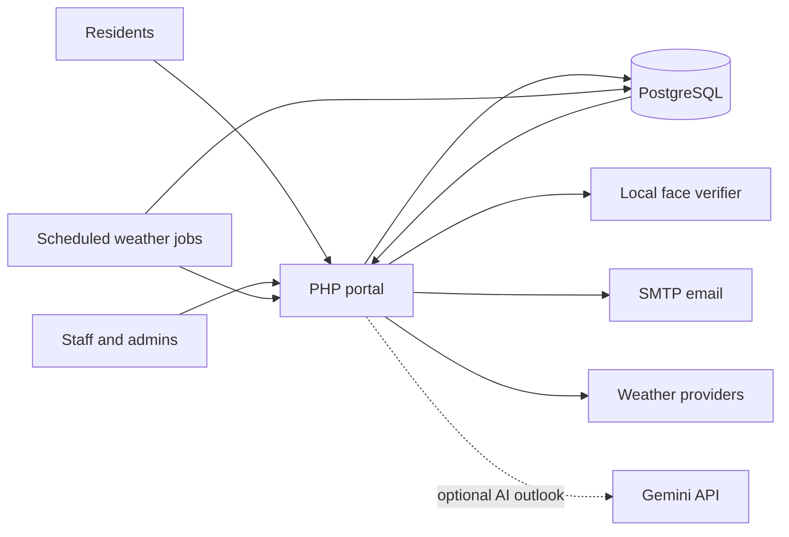

# Barangay Inosluban Portal

A PHP web application for resident services and barangay staff administration.
Residents can manage their account, request documents, book appointments, and
submit blotter reports. Staff review requests; administrators manage users,
announcements, weather information, and disaster alerts.

## How the system fits together



The portal is served by Apache. It uses PostgreSQL for accounts, requests,
announcements, alerts, and audit records. Email is sent through the configured
SMTP service. Weather jobs can run on a schedule; the Gemini-powered outlook is
optional.

## Main features

- **Resident services:** registration and login, profile management, document
  requests, appointments, blotter reports, announcements, and request tracking.
- **Staff tools:** request review, document preparation and pickup verification,
  household registry access where authorized, leave requests, and time logs.
- **Staff and admin sign-in:** password login followed by server-side face
  matching. Staff shift time starts only after face verification succeeds.
- **Administration:** staff and account management, audit logs, analytics,
  announcements, weather dashboards, and disaster preparedness alerts.
- **Email notifications:** password recovery and verification, document pickup
  QR codes, weather announcements, and disaster alerts.
- **Weather information:** current conditions, hourly data, forecasts, and
  archived daily observations.

## Run locally with XAMPP

1. Put the project in `C:\xampp\htdocs\PHP_project` and start Apache.
2. Install the project dependencies from the project directory:

   ```powershell
   composer install
   ```

3. Install Python 3.13 and the face-verification dependencies:

   ```powershell
   py -3.13 -m venv .venv-face
   .\.venv-face\Scripts\python.exe -m pip install -r requirements-face.txt
   ```

   Set `FACE_VERIFIER_COMMAND` in `.env` to the full path of
   `.venv-face\Scripts\python.exe`. MediaPipe and OpenCV need a supported
   Python runtime.
4. Enable the PHP `pdo_pgsql`, `curl`, `openssl`, and `proc_open` features in
   XAMPP's `php.ini`, then restart Apache.
5. Create a PostgreSQL database and load the base schema:

   ```powershell
   psql -U <database-user> -d <database-name> -v ON_ERROR_STOP=1 -f schema.sql
   ```

6. Configure the environment variables below in the project-root `.env` file
   (or in the environment used to start PHP).
7. Open [http://localhost/PHP_project/](http://localhost/PHP_project/) and
   register a resident account.

The project does not create a PostgreSQL server or database for you. Make sure
PostgreSQL is running and that the configured database already exists.

## Configuration

Set either `DATABASE_URL` or all five `DB_HOST`, `DB_PORT`, `DB_NAME`, `DB_USER`,
and `DB_PASSWORD` values. `DATABASE_URL` must be a PostgreSQL connection URL.
Use a private environment or secret file for credentials; never commit them.

The app loads Render's `/etc/secrets/.env` file and then the project-root
`.env`. Variables already present in the process environment take precedence.

| Variables | Needed for |
| --- | --- |
| `DATABASE_URL` or `DB_*` | PostgreSQL connection; required |
| `SMTP_HOST`, `SMTP_PORT`, `SMTP_USERNAME`, `SMTP_PASSWORD`, `MAIL_FROM` | Email delivery |
| `MAIL_FROM_NAME` | Optional display name for outgoing email |
| `APP_BASE_URL` | Public site URL used in email links; defaults to the hosted portal |
| `APP_TIMEZONE` | Optional application timezone; defaults to `Asia/Manila` |
| `GEMINI_API_KEY`, `GEMINI_MODEL` | Optional admin AI outlook |
| `WEATHER_LOCATION`, `WEATHER_LATITUDE`, `WEATHER_LONGITUDE`, `WEATHER_TIMEZONE` | Optional weather location overrides |
| `FACE_VERIFIER_COMMAND` | Python executable used by the local face verifier; defaults to `python` on Windows and `python3` elsewhere |
| `FACE_ENCRYPTION_KEY` | Required base64-encoded random 32-byte key used to encrypt face templates |
| `FACE_ENROLLMENT_SETUP_TOKEN` | Required random token for the initial administrator enrollment; only used until an active admin is enrolled |
| `FACE_ADMIN_RECOVERY_TOKEN` | Required separate random token so an admin can re-enroll only their own face if normal verification is unavailable |

For Brevo, use its SMTP host, SMTP login and key, and a verified sender address.
On Render, the app uses port `2525` when Brevo is configured with port `587`.
Other providers use the configured SMTP port. Email features require valid SMTP
settings.

Generate the face-authentication secrets with PHP and keep their values
private:

```powershell
php -r "echo base64_encode(random_bytes(32)), PHP_EOL;"
php -r "echo bin2hex(random_bytes(32)), PHP_EOL;"
php -r "echo bin2hex(random_bytes(32)), PHP_EOL;"
```

Use the first value for `FACE_ENCRYPTION_KEY`, the second for
`FACE_ENROLLMENT_SETUP_TOKEN`, and the third for `FACE_ADMIN_RECOVERY_TOKEN`.
Back up the encryption key securely: losing it
makes stored face templates unusable. Do not put any of these values in source
control.
For local XAMPP, set `FACE_VERIFIER_COMMAND` to the full path of the Python
executable in `.venv-face\Scripts\python.exe`.

After setting up the database and secrets, sign in with an active admin
account and follow the one-time setup page. Provide its setup token and complete
the camera steps. Then use **Face enrollment** in the staff directory to enroll
staff and any additional admins. Keep the recovery token with the
system operator; it bypasses normal face matching only to re-enroll that same
admin, and requires the admin password plus physical possession of the token.
Enrolled staff/admins must sign in with their
password and pass the camera check. Use HTTPS in deployment (localhost is
allowed for local camera access).

Face frames are processed in memory by the server and are not saved. PostgreSQL
stores the encrypted OpenCV face template, enrollment metadata, and minimal
authentication-attempt records. The browser uses MediaPipe for camera guidance;
PHP invokes the Python MediaPipe and OpenCV verifier to perform the actual face
match. This challenge is a
best-effort liveness check, not certified anti-spoofing: it cannot guarantee
protection from sophisticated video replay, masks, or deepfakes. Keep passwords
required and limit enrollment to supervised staff/admin setup. An administrator
can re-enroll a staff member who cannot pass the face check.
The server-side MediaPipe landmark model is bundled under protected storage and
its SHA-256 checksum is verified before use.

### Generate face-authentication secrets

From PowerShell:

```powershell
C:\xampp\php\php.exe -r "echo base64_encode(random_bytes(32)), PHP_EOL;"
C:\xampp\php\php.exe -r "echo bin2hex(random_bytes(32)), PHP_EOL;"
C:\xampp\php\php.exe -r "echo bin2hex(random_bytes(32)), PHP_EOL;"
```

Put the three outputs in `.env` as `FACE_ENCRYPTION_KEY`,
`FACE_ENROLLMENT_SETUP_TOKEN`, and `FACE_ADMIN_RECOVERY_TOKEN`, respectively.
Never commit `.env` or share these values.

## Deploy with Docker / Render

The [Dockerfile](./Dockerfile) builds the PHP 8.3 Apache app, installs Composer
dependencies, creates an isolated Python environment for face verification,
and enables PostgreSQL and cURL extensions. Configure the database, email,
face-authentication secrets, and any optional AI/weather variables in the
deployment environment. For Render, use a secret `.env` file or service
environment variables, and use the database's internal URL when the services
are in the same region.

### Optional scheduled weather jobs

The admin weather page can refresh weather data on demand. For automatic
updates, configure these Render Cron Jobs to use the same repository, branch,
Dockerfile, region, and database settings as the web service:

| Schedule (UTC) | Command | Purpose |
| --- | --- | --- |
| `0 * * * *` | `php /var/www/html/weather_cron.php` | Fetch current conditions, hourly data, and forecast |
| `5 16 * * *` | `php /var/www/html/weather_daily_cron.php` | Archive the previous Philippine calendar day's observations |

The daily job runs at 12:05 AM Philippine time. These scripts are command-line
only and cannot be run as web pages. Weather forecasts may create draft
announcements for an administrator to review before publication.

## Security and data

- Passwords are hashed; SQL uses PDO prepared statements.
- State-changing forms use session-based CSRF tokens.
- Role checks restrict resident, staff, and administrator features.
- Staff and admin routes require a recent face verification after password
  login. Face templates are encrypted at rest with AES-256-GCM; original camera
  frames are not retained.
- User-provided output is escaped before it is rendered as HTML.
- Remote PostgreSQL connections require SSL.
- Keep `.env` and all database or mail credentials private.

The schema in [schema.sql](./schema.sql) defines the base PostgreSQL tables; the
application also applies selected backward-compatible schema updates when
features are used. `schema.sql` is a schema backup, not a backup of resident
data. Back up the database separately.

## Project layout

- `index.php`, `register.php`, and other root PHP files: portal pages and
  request handlers.
- `includes/`: shared database/session helpers, authorization, notifications,
  email templates, and business logic.
- `config/`: environment configuration and SMTP mailer.
- `assets/`: CSS, JavaScript, and images.
- `templates/emails/`: HTML email templates.
- `storage/`: protected document templates and uploaded files.
- `schema.sql`: PostgreSQL base schema.

For a feature overview, see **Main features** above. Start with `index.php` to
trace the login flow, `includes/bootstrap.php` for shared session/database
setup, and the relevant page in the project root for a specific service.

Run the face-verifier unit tests with:

```powershell
py -3.13 -m unittest discover -s tests
```
